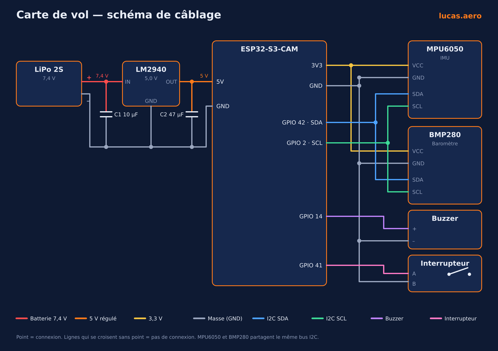

# 🚀 Ma première fusée électronique — kit lucas.aero (v1)

Une fusée imprimable en 3D, équipée d'une carte de vol maison qui **filme et enregistre tout le vol** sur carte SD : accélérations et rotations à 1 000 mesures par seconde, pression et altitude à 50 mesures par seconde.

📱 Le projet raconté en épisodes : Instagram @lucas.aero.fr 

> ⚠️ **Sécurité, à lire avant tout.** Ce kit fournit la structure et l'électronique, **pas** la propulsion.
> Utilise uniquement des **moteurs du commerce**, montés selon la notice du fabricant, et lance **uniquement dans un cadre encadré** (club de fusées, campagne Planète Sciences…), en respectant la réglementation et les règles du club.
> Ne fabrique jamais de moteur ou de propergol toi-même.

---

## 📦 Contenu du dépôt

| Dossier | Contenu |
|---|---|
| `stl/` | Pièces de la fusée à imprimer en 3D |
| `docs/` | câblage |

> 💾 **Le code de la carte de vol et l'outil de relecture des vols (vidéo + données) ne sont pas inclus.** Un pack complet arrive bientôt. 

---

## 🔌 Électronique de vol

### Composants

| Composant | Rôle |
|---|---|
| ESP32-S3-CAM | Cerveau de la carte + caméra + lecteur microSD intégré |
| MPU6050 | Centrale inertielle : accéléromètre (±16 g) + gyroscope (±2000 °/s) |
| BMP280 (ou BME280) | Baromètre → altitude |
| Buzzer | Signale l'état de la carte |
| Interrupteur | Arme la carte et lance l'enregistrement |
| Carte microSD | Enregistre `data.csv`, `frames.csv`, `video.mjpg` |
| Batterie LiPo 2S (7,4 V) | Alimentation |
| Régulateur LM2940-5.0 | Abaisse la tension de la LiPo à 5 V |
| Condensateurs 10 µF (entrée) et 47 µF (sortie) | Stabilité du régulateur |

### Câblage

| Broche ESP32-S3-CAM | Connecté à |
|---|---|
| GPIO 42 | SDA du bus I2C (MPU6050 + BMP280) |
| GPIO 2 | SCL du bus I2C (MPU6050 + BMP280) |
| GPIO 14 | Buzzer |
| GPIO 41 | Interrupteur, l'autre borne à la masse (GND) |
| 3V3 / GND | Alimentation des capteurs |

Le MPU6050 et le BMP280 partagent le même bus I2C : deux fils seulement pour deux capteurs, chacun répond à sa propre adresse.

Alimentation : LiPo 2S → LM2940-5.0 (10 µF en entrée, 47 µF en sortie) → entrée 5 V de l'ESP32-S3-CAM.

> Le schéma propre sous KiCad arrive dans une prochaine version (et en vidéo 👀).

### Ce que dit le buzzer

| Son | Signification |
|---|---|
| 2 bips courts + 1 long | Carte armée, enregistrement lancé ✅ |
| 5 bips rapides | Problème détecté (carte SD, caméra ou capteur) ❌ |

---

## 🛠️ Structure

- Pièces imprimées en 3D, dans `stl/` (du nez vers la queue) :
  - `01_ogive.stl` : ogive
  - `02_baie_electronique.stl` : baie électronique (accueille la carte de vol)
  - `03_capot_camera.stl` : capot de la caméra
  - `04_corps.stl` : corps
  - `05_ailerons.stl` : section arrière avec les 4 ailerons
- Paramètres d'impression conseillés : PLA
- Propulsion : compatible avec la gamme de moteurs **Klima classe C** (cluster de 4 moteurs lors de mes vols)
- Récupération : parachute éjecté par la charge de dépotage du moteur

---

## ✅ Checklist de pré-lancement

**La veille**
- [ ] LiPo chargée, tension vérifiée au multimètre
- [ ] Carte microSD vidée et insérée
- [ ] Test complet au sol : interrupteur → 2 bips courts + 1 long → enregistrement → relecture des fichiers sur PC
- [ ] Électronique bien fixée dans la fusée (rien ne doit bouger sous l'accélération)
- [ ] Structure inspectée : ailerons, fixations, aucune fissure
- [ ] Parachute plié, suspentes démêlées, protection contre la chaleur de l'éjection en place

**Sur le terrain**
- [ ] Fusée présentée au responsable de sécurité du club ou de la campagne
- [ ] Moteurs du commerce installés selon la notice du fabricant, procédure validée par le responsable
- [ ] Batterie branchée, interrupteur basculé, **fusée immobile pendant ~1 s** (calibration du gyroscope)
- [ ] 2 bips courts + 1 long entendus. Si 5 bips rapides : on ne lance pas, on vérifie
- [ ] Caméra dégagée, objectif propre
- [ ] Zone dégagée, procédure de lancement du club respectée

**Après le vol**
- [ ] Rebasculer l'interrupteur pour arrêter l'enregistrement, puis débrancher la batterie
- [ ] Récupérer la carte SD avant toute manipulation
- [ ] Relire les données et la vidéo

---

## 📜 Licence

Ce projet est sous licence **Creative Commons BY-NC 4.0** :
- ✅ Tu peux l'imprimer, le modifier, le partager
- ✅ À condition de citer lucas.aero
- ❌ Interdit de le vendre ou de l'utiliser commercialement

Tu as construit ta version ? Tague-moi, je veux voir ça 🚀
